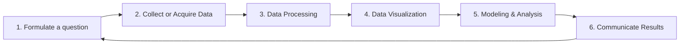

# Data Science Textbook

*Henrico County Public Schools · Updated August 2025 · Sara Barbolish*

## Contents

**Unit 1: Data Literacy**
- [The Data Cycle](#the-data-cycle)
- [Types of Data](#types-of-data)
- [Data Questions](#data-questions)
- [Background Research](#background-research-reliability)

**Unit 2: Visualizations**
- [Histograms & Boxplots](#histograms-and-boxplots)
- [Scatterplots & Line Graphs](#scatterplots-and-line-graphs)
- [Pie Charts & Bar Charts](#pie-charts-and-bar-charts)
- [Heatmaps & Other Visualizations](#heatmaps-and-other-visualizations)
- [Choosing Visualization Types](#what-graph-can-i-use)
- [Data Processing](#data-processing)
- [Data Cleaning](#data-cleaning)
- [pandas cheat sheet](#pandas-cheat-sheet)
- [Descriptive Statistics](#descriptive-statistics)
- [Statistics in Python](#statistics-using-python)
- [Creating Visualizations](#creating-visualizations)
- [Advanced Visualizations](#advanced-visualizations)
- [matplotlib cheat sheet](#matplotlib-cheat-sheet)
- [Documentation](#documentation)

**Unit 3: Mathematical Models**
- [Linear Regression](#linear-regression)
- [Polynomial Regression](#polynomial-regression)
- [Logistic Regression](#logistic-regression)
- [Multiple Predictors](#logistic-regression-with-multiple-predictors)
- [Noise & Overfitting](#noise-and-overfitting)
- [Normal Distribution](#normal-distribution)
- [Decision Trees](#decision-trees)
- [Algorithm Selection](#algorithm-selection)

**Resources**
- [Data Question Flowchart](#data-question-flow-chart)
- [Data Question Distiller](#data-question-distiller)
- [Attribute Exploration Sheet](#attribute-exploration)
- [VS Code Directions](#setting-up-vs-code)
- [Data Sources List](#data-sources-for-projects)

---

# Unit 1: Data Science for All

### Standard 1: Data Questions and the Data Cycle (DS.1)

| Learning Experience | I can… | Not Yet | Almost | Yes |
|---|---|:-:|:-:|:-:|
| #1: Data Questions | I can create a research question for data analysis | ☐ | ☐ | ☐ |
| | I can develop questions for an exploratory data analysis based on a data set or multiple data sets | ☐ | ☐ | ☐ |
| #2: The Data Cycle | I can identify the steps of the data cycle | ☐ | ☐ | ☐ |
| | I can use the steps of the data cycle (except parts of analysis) to explore data | ☐ | ☐ | ☐ |

### Standard 2: Storytelling (DS.3, DS.5)

| Learning Experience | I can… | Not Yet | Almost | Yes |
|---|---|:-:|:-:|:-:|
| #1: Data Literacy | I can interpret the meaning of a data-heavy report | ☐ | ☐ | ☐ |
| | I can interpret and critique visualizations created by a variety of sources | ☐ | ☐ | ☐ |
| #2: Storytelling | I can combine data resources and visualizations to tell a data story that can describe something in the real world | ☐ | ☐ | ☐ |

---

## The Data Cycle

**The Data Cycle:** In the data cycle, a data scientist will ask a question, collect or acquire the data needed to answer that question, perform a data analysis (including pre-processing and processing, visualizations, models, and general analysis) and then communicate their findings. Once they have communicated their findings, they will notice that new questions have been brought to light. These may come in the form of a further question, the need for an additional attribute of the data, the need for different data (different people, different place, different time, etc.), or a critique of the data analysis process. Once that question is created, the data cycle is repeated.



1. Formulate a question
2. Collect or acquire data
3. Data processing
4. Data visualization
5. Modeling & analysis
6. Communicate results → back to step 1

---

## Types of Data

| Type | Definition | Example | Questions to Ask | Notes |
|---|---|---|---|---|
| **Quantitative / Numeric** | Quantitative data uses numbers to describe an amount of something. Measures like mean and median would make sense with this data. Basic arithmetic would also make sense with this type of data. | age, year, number of pets, height | What is "normal"? What is the range of the data? How "different" is one data point? *These questions ask about the spread of the data.* | Not all data using numbers is quantitative. For example, "TV channel" or "ID number" would not be quantitative. |
| **Ordinal** | Ordinal data is data that can be put in an order. Quantitative data is a type of ordinal data, but ordinal data does not need to be numeric. | Ordinal data often has to do with "rating." For example: Strongly disagree, disagree, agree, strongly agree · Poor, good, great · On a scale of 1 to 10, how much does the injury hurt? Dates may also be considered ordinal. | What is "normal"? What is the range of the data? How "different" is one data point? *These questions ask about the spread of the data.* | |
| **Categorical** | Categorical data puts respondents into groups. | Categorical data is often collected using a multiple choice or multiple answer question. It cannot be ordered. For example, favorite season breaks respondents into "spring," "summer," "fall," and "winter." | What is most common? What is the makeup of the data? *These questions ask about the composition of the data.* | Some categories would require an "other" in order to categorize. This is particularly true of categories like race, where people differ a lot. It is important to consider how many people would fall into the "other" category. If it would be a large number of respondents, consider collecting qualitative data instead. |
| **Qualitative** | Qualitative data is typically words and descriptions. These types of questions are useful when you can't clearly categorize questions. | These are used for open-ended questions. For example: "What was your favorite part of this week?" or "If you could have any superpower, what would it be?" | How do people feel about this? Are there patterns in the data? *These questions ask about patterns and descriptions in the data.* | |

---

## Data Questions

| Term | Definition |
|---|---|
| **Data Question** | A data question is a question that can be answered with data and facilitate a quality data analysis. A data question might arise from a broad question or a subjective question. Answering the question allows further questions to arise. Answering the question should contribute to a larger understanding of the world or an overarching question. |
| **Research Project** | A research project follows the traditional data cycle: 1. Choose a topic · 2. Ask a specific question · 3. Collect data · 4. Perform a data analysis · 5. Draw a conclusion · 6. Ask a new question |
| **Exploratory Data Analysis** | The data scientist must "make sense of" the data. This makes a different data cycle: 1. Acquire or collect data · 2. Explore the data · 3. Ask a specific question · 4. Perform a data analysis · 5. Draw a conclusion · 6. Ask a new question |
| **Specific** | A specific question is one that is clear and/or well defined.<br>❌ Non-example: Are girls more successful than boys?<br>⭐ Example: Do girls earn higher high school GPAs than boys? |
| **Objective** | An objective question is one that is not looking for an individual's / the data scientist's opinion. To capture opinion, focus on public perception of the question.<br>❌ Non-example: What is the best book ever written?<br>⭐ Example: What books are commonly people's favorites? |
| **Fruitful** | A fruitful question is one that cannot be answered in just a few sentences. A question that is not fruitful has one simple answer/explanation and can be looked up; it is a fact or figure.<br>❌ Non-example: How many people live in the United States?<br>⭐ Example: How has the population of the United States fluctuated over time? |

**Be careful not to treat "fruitful" and "specific" as opposites.**

| | Not Fruitful | Fruitful |
|---|---|---|
| **Specific** | ❌ Of all roller coasters in the United States that are currently operational, which roller coaster has the fastest maximum speed? | ⭐ Considering all roller coasters in the United States that are currently operational, what factors correlate with maximum speed? Are these correlations different within the top 10% fastest roller coasters? |
| **Not Specific** | ❌ Which roller coaster is the fastest? | ❌ Are there things about the fastest roller coasters that make them different? |

---

## Background Research Reliability

### Reliability Checklist

Make sure you can check all of these boxes before using a source!

| Category | Questions |
|---|---|
| **Currency** | When was the site created and last updated? Do all the links on the site work? |
| **Relevance** | Looking past the headline, does the information relate to your purposes? Will it help you? |
| **Authority** | Does the site have an author or an organization that runs it? Is the author or organization reliable? Can the public edit the site? (Be careful if it can.) What is the domain? (You can trust ".gov" and ".edu." Use caution with ".org" and ".com.") |
| **Accuracy** | Does the site have a disclaimer? (If so, stories may not be true.) Is the site biased because it is promoting a cause? (The domain ".org" promotes non-profit causes.) Are there any typos or grammatical errors? (You don't want to see any.) |
| **Purpose** | Is the content factual or opinionated? Are the opinions supported with facts? Does the site list its resources for the information presented? |

### General Rules

**Reliable and Helpful Sites**
- [Snopes](http://www.snopes.com/) – the best source for factual information about rumors
- [Hoax-Slayer](http://www.hoax-slayer.com/) – email hoaxes & Internet scams
- [Urban Legends and Folklore](http://urbanlegends.about.com/) from About.com
- [Truth or Fiction](http://www.truthorfiction.com/)
- [Straight Dope](http://www.straightdope.com/) – mission is to fight ignorance
- [Issues and Controversies](https://icof.infobase.com/) (Clever)
- [Britannica.com/procon](http://britannica.com/procon)
- Reliable News: NPR, CNN, Washington Post, London Times, Oregonian, BBC, and Reuters
- For more information and a list of tested sites [click here](https://docs.google.com/document/d/10eA5-mCZLSS4MQY5QGb5ewC3VAL6pLkT53V_81ZyitM/preview).

**What to Avoid**
- Websites that end in "lo" (ex: Newslo)
- Common news websites that end in ".com.co"
- News stories that known/reputable news sites are not also reporting on
- Odd domain names
- Bloggers (ex: BuzzFeed Community Posts, Kinja blogs, Forbes blogs)
- Bad web design and use of ALL CAPS

---

# Unit 2: Visualizations

### Standard 1: Visualizations (DS.6)

| Learning Experience | I can… | Not Yet | Almost | Yes |
|---|---|:-:|:-:|:-:|
| #1: Visualization Effectiveness | I can evaluate the effectiveness of a visualization and identify what aspects of a visualization contribute to the effectiveness | ☐ | ☐ | ☐ |
| #2: Emerging Visualizations | I can interpret emerging visualizations, which show any number of attributes | ☐ | ☐ | ☐ |
| | I can describe the advantages and disadvantages of a given emerging visualization | ☐ | ☐ | ☐ |
| #3: Choosing Visualizations | I can choose and create the most effective visualization given my data. For example: (1) I can differentiate data best represented as a scatter plot versus a line graph; (2) I can differentiate data best represented as a histogram versus a bar chart. | ☐ | ☐ | ☐ |

### Standard 2: Data Wrangling (DS.8, DS.12)

| Learning Experience | I can… | Not Yet | Almost | Yes |
|---|---|:-:|:-:|:-:|
| #1: Choosing Data | I can find high quality data to use for data science projects | ☐ | ☐ | ☐ |
| #2: Importing Data | I can import data in a CSV document into a Python notebook for analysis | ☐ | ☐ | ☐ |
| | I can create a data frame using the data from my file | ☐ | ☐ | ☐ |
| | I can subdivide datasets in order to analyze with additional attributes | ☐ | ☐ | ☐ |

### Standard 3: Data Cleaning (DS.8, DS.12)

| Learning Experience | I can… | Not Yet | Almost | Yes |
|---|---|:-:|:-:|:-:|
| #1: Data Cleaning Theories | I can describe the common problems in "messy data" and their solutions | ☐ | ☐ | ☐ |
| | I can identify data cleaning decisions that introduce bias & avoid it in my analysis | ☐ | ☐ | ☐ |
| #2: Data Cleaning Practice | I can clean data by omitting missing values, without introducing bias | ☐ | ☐ | ☐ |
| | I can clean data in other ways as needed | ☐ | ☐ | ☐ |

### Standard 4: Scatterplots and Line Graphs (DS.10, DS.13)

| Learning Experience | I can… | Not Yet | Almost | Yes |
|---|---|:-:|:-:|:-:|
| #1: Interpretation | I can interpret a scatterplot and, if appropriate, use it to make predictions | ☐ | ☐ | ☐ |
| | I can interpret scatterplots and line graphs that show additional attributes and use those attributes to compare | ☐ | ☐ | ☐ |
| #2: Creation | I can create well labeled and organized scatter plots and line graphs in Python | ☐ | ☐ | ☐ |
| | I can subdivide a dataframe to create a well labeled and organized plot | ☐ | ☐ | ☐ |

### Standard 5: Histograms and Box Plots (DS.10, DS.13)

| Learning Experience | I can… | Not Yet | Almost | Yes |
|---|---|:-:|:-:|:-:|
| #1: Interpretation | I can use a histogram to estimate the mean and its relationship to the median | ☐ | ☐ | ☐ |
| | I can interpret a histogram | ☐ | ☐ | ☐ |
| | I can use box plots to identify measures of central tendency | ☐ | ☐ | ☐ |
| #2: Creation | I can create a well labeled and organized histogram in Python | ☐ | ☐ | ☐ |

### Standard 6: Pie Charts and Bar Graphs (DS.10, DS.13)

| Learning Experience | I can… | Not Yet | Almost | Yes |
|---|---|:-:|:-:|:-:|
| #1: Interpretation | I can interpret pie charts and other representations of parts of a whole | ☐ | ☐ | ☐ |
| | I can interpret proportional representations including heat maps and bubble charts | ☐ | ☐ | ☐ |
| #2: Creation | I can create a well labeled and organized pie or donut chart in Python | ☐ | ☐ | ☐ |
| | I can create a well labeled and organized bar chart in Python | ☐ | ☐ | ☐ |

---

## Histograms and Boxplots

| Visualization | Number & Type of Attributes | Purpose | Possible Data Question |
|---|---|---|---|
| **Histogram** | One numeric attribute | Shows the *spread* of data | How tall is a typical 12-year-old? |
| **Stacked Histogram** | One numeric attribute, one categorical attribute | Shows the *spread* of data; compares two subsets | How tall is a typical 12-year-old? Is that different for girls and boys? |
| **Box and Whisker** | One numeric attribute | Shows the *spread* of data | How tall is a typical 12-year-old? |
| **Side-by-Side Boxplot** | One numeric attribute, one categorical attribute | Shows the *spread* of data; compares two subsets | How tall is a typical 12-year-old? Is that different for girls and boys? |

**Note: Histograms (skew)**
- **Negatively skewed:** the tail points left (negative direction). Mean < Median < Mode.
- **Normal (no skew):** the curve is perfectly symmetrical. Mean = Median = Mode.
- **Positively skewed:** the tail points right (positive direction). Mode < Median < Mean.

**Note: Box Plots**

```
 min                lower Q1     median     upper Q3                max
  |----- whisker -----[=============|=============]----- whisker -----|
                      |<--- interquartile range (IQR) --->|
```

---

## Scatterplots and Line Graphs

| Visualization | Number & Type of Attributes | Purpose | Possible Data Question |
|---|---|---|---|
| **Scatterplot** | Two numeric attributes | Shows the *relationship* between two variables | What is the relationship between a person's height and their weight? |
| **Subsetted Scatterplot** | Two numeric attributes, one categorical attribute | Shows the *relationship* between three variables | What is the relationship between a person's height and weight? Does that vary for girls and boys? |
| **Line Graph** | Two numeric attributes (one is *continuous*) | Shows the *relationship* between two variables. Really good for *time*. | How have gas prices varied over time? |
| **Overlaid Line Graph** | Two numeric attributes (one is *continuous*), one categorical attribute | Shows the *relationship* between three variables | How have gas prices varied over time in VA, WV, and NC? |
| **Scatter Bubble Chart** | Three numeric attributes, optional one categorical attribute | Shows the *relationship* between (up to) four variables | What is the relationship between a person's height and their weight? Does that vary with age? |
| **Area Chart** | Two numeric attributes (one is *continuous*) | Shows the *relationship* between two variables. Really good for *time*. | How have gas prices varied over time? |

**Correlation:** Points that rise from left to right show a **positive correlation**. Points that fall from left to right show a **negative correlation**. Points with no pattern show **no correlation**.

> **Note:** Additional attributes can be added using the size (numeric) or shape (categorical) of each dot. Using a scale, the colors could also represent a numeric variable.

---

## Pie Charts and Bar Charts

| Visualization | Number & Type of Attributes | Purpose | Possible Data Question |
|---|---|---|---|
| **Pie Chart** | One categorical attribute | Shows the *composition* of data | What portion of people prefer summer, and what portion prefer winter? |
| **Donut Chart** | One categorical attribute | Shows the *composition* of data | What portion of people prefer summer, and what portion prefer winter? |
| **Side-by-Side Pie Charts** | Two categorical attributes | Shows the *composition* of data | What portion of people prefer summer, and what portion prefer winter, broken down by age? |
| **Stacked Area Chart** | One numeric (continuous) and one categorical attribute | Shows the *composition* of data and *change over time* | How has the number of cars sold changed over time, by brand? |
| **Bar Chart** (vertical or horizontal) | One *unique* categorical attribute & numeric, or just one categorical | *Compares* the amount of something | What is the most popular TV show? |
| **Stacked Bar Chart** | One unique categorical, one non-unique categorical, one numeric | *Compares* the amount of something and breaks down by *composition* | What is the most popular TV show? Are there changes in TV show preference based on your gender? |
| **Percentage Bar Chart** | Two categorical variables | Shows and *compares* the *composition* of data | What portion of people prefer summer, and what portion prefer winter? How does that compare by grade? |
| **Grouped Bar Chart** | One unique categorical, one non-unique categorical, one numeric | *Compares* the amount of something with subsets | What is the most popular TV show? Are there changes in TV show preference based on your age group? |

---

## Heatmaps and Other Visualizations

| Visualization | Number & Type of Attributes | Purpose | Possible Data Question |
|---|---|---|---|
| **Heatmap** | Two categorical attributes, one numeric attribute | Shows the *relationship* between three variables | How does the brand of a car and its color affect the price? |
| **Table** | Any number or type of attribute | Shows *all data* or a subset of the data in detail | What is the relationship between a person's height and their weight? Does that vary for girls and boys? |
| **Geographic Heatmap** | One categorical, location (usually latitude & longitude) | Compares a variable by *location* | What parts of the country have the highest unemployment rates? |
| **Matrix** | Any number of categorical attributes | Shows counts of *all data* or a subset of the data in detail | How many people are unemployed? How does that break down by race, gender, and age? |
| **Proportion / Bubble Chart** | One categorical, location (usually latitude & longitude) | *Compares* the amount of something | What is the most popular TV show? |

**Other Visualizations:** Most visualizations you will see in real data analyses are a combination or adaptation of these types of visualizations. When coding, check the documentation or graph galleries like [python-graph-gallery.com](https://python-graph-gallery.com/).

---

## What Graph Can I Use?

| Visualization | Attributes |
|---|---|
| **One Attribute** | |
| Histogram | One numeric attribute |
| Box and Whisker | One numeric attribute |
| Pie Chart | One categorical attribute |
| Donut Chart | One categorical attribute |
| Bar Chart | One categorical attribute |
| **Two Attributes** | |
| Stacked Histogram | One numeric attribute, one categorical attribute |
| Side-by-Side Box Plots | One numeric attribute, one categorical attribute |
| Scatterplot | Two numeric attributes |
| Line Graph | Two numeric attributes (one is continuous) |
| Area Chart | Two numeric attributes (one is continuous) |
| Side-by-Side Pie Charts | Two categorical attributes |
| Stacked or Grouped Bar Charts | Two categorical attributes |
| Percentage Bar Chart | Two categorical variables |
| Proportion / Bubble Chart | One numeric, one categorical (optional second categorical) |
| **Three or More Attributes** | |
| Stacked or Overlaid Area Chart | Two numeric (one continuous) and one categorical attribute |
| Subsetted Scatterplot | Two numeric attributes, one categorical attribute |
| Overlaid Line Graph | Two numeric attributes (one is continuous), one categorical |
| Scatter Bubble Chart | Three numeric attributes, optional one categorical attribute |
| Heatmap | Two categorical attributes, one numeric attribute |
| Geographic Heatmap | One numeric and location (usually latitude & longitude) |
| Table | Any number & any type |
| Matrix | Any number of categorical attributes |

*This list does not include all possible visualizations!*

---

## Data Processing

### Python Steps

| Step | Code |
|---|---|
| Import libraries | `import pandas as pd` |
| Read in the data | `my_df = pd.read_csv('./NAME OF FILE.csv')` |
| Explore the data | `my_df.head()`<br>`my_df.info()`<br>`my_df.describe()` |
| Isolate one attribute | `one_attribute = my_df['Attribute Name']`<br>`print(one_attribute)` |

### Key Vocabulary

| Term | Meaning |
|---|---|
| `.head()` | Shows the first 5 rows of a dataframe |
| `.info()` | Shows each attribute, the number of cases that have a value for that attribute, and the data type of the attribute: **int64** (a number with no decimal), **float64** (a number with a decimal), **object** (a word) |
| `.describe()` | Shows the descriptive statistics (mean, median, mode, maximum, minimum, quartiles, standard deviation) of all attributes in the dataset |
| **Attribute** | An "attribute" is a column of a table. It is a piece of information that describes each case. Most of the time, each case will have multiple attributes. |

### Example

```python
import pandas as pd

roller_coaster_df = pd.read_csv('./roller_coaster.csv')
print(roller_coaster_df.head())
print(roller_coaster_df.info())
print(roller_coaster_df.describe())

heights = roller_coaster_df['Max_Height']
print(heights)
```

📝 [Practice Assignment](https://docs.google.com/document/d/1PMjDj6zO6qPFYhlMVR5hBMa8_I1oqGpgk54Cm8F5qDc/edit?usp=sharing)

---

## Data Cleaning

### Python Commands

| Command | What it does |
|---|---|
| `pd.to_numeric()` | Changes all values to numbers |
| `.str.strip()` | Gets rid of white space |
| `.loc[]` | Find and change specific values |
| `.str.upper()` / `.str.lower()` / `.str.title()` | Makes words UPPER CASE, lower case, or Title Case |
| `pd.to_datetime()` | Puts all dates into the same format |
| `.map()` | Replaces values into categories |
| `.replace()` | Replaces specific values |
| `np.nan` | Standard "missing" value |
| `errors='coerce'` | Add this when you are changing data types |
| `.dropna()` | Drops lines with any missing values |
| `.drop_duplicates()` | If more than one line is exactly the same, drops copies |

### Key Vocabulary

**Missing at Random / Missing Not at Random:** Data is missing *not* at random if there is some reason, other than chance, that a field was left blank. For example, asking "Are you a citizen?" may result in values that are missing not at random and should not be dropped.

### Example

Messy data (`students_grades.csv`):

| name | Grade | email | submission_date | passed |
|---|---|---|---|---|
| Alice Smith | 88 | alice_smith@gmailcom | 2023-05-01 | Yes |
| bob jones | 92 | bob.jones@gmail.com | 2023/05/03 | y |
| Charlie Zhang | | charliez@gmail.com | 05-04-2023 | TRUE |
| Dana O'Brien | 74 | dana.obrien@@gmail.com | May 5 2023 | 1 |
| Eli | 105 | eli123@gmail.com | NULL | No |
| John Smith | twenty | jws12@gmail.com | 2023/05/03 | |
| Alice Smith | 88 | alice_smith@gmailcom | 2023-05-01 | Yes |

```python
import pandas as pd
import numpy as np

df = pd.read_csv("students_grades.csv")

# Strip whitespace and standardize capitalization for names
df['name'] = df['name'].str.strip().str.title()

# Convert grades to numeric
df['Grade'] = pd.to_numeric(df['Grade'], errors='coerce')

# Cap grades between 0 and 100
df.loc[df['Grade'] > 100, 'Grade'] = 100
df.loc[df['Grade'] < 0, 'Grade'] = 0

# Fix common email typos using replace
df['email'] = df['email'].str.replace('@@', '@')
df['email'] = df['email'].str.replace('gmailcom', 'gmail.com')

# Convert submission_date to datetime
df['submission_date'] = pd.to_datetime(df['submission_date'], errors='coerce')

# Normalize 'passed' column
passed_map = {
    'yes': True, 'y': True, '1': True, 'true': True,
    'no': False, 'n': False, '0': False, 'false': False
}
df['passed'] = df['passed'].astype(str).str.lower().map(passed_map)

# Replace missing "passed" rows (np.nan) with False
df['passed'] = df['passed'].replace({np.nan: False})

# Remove duplicate rows
df = df.drop_duplicates()

# Drop rows with missing critical values (name, email, grade)
df = df.dropna(subset=['name', 'email', 'Grade'])
```

📝 [Practice Assignment](https://docs.google.com/document/d/1hgvOfzSHJdrtz8MycDg82D0hpL_L-FSWExAkJ4Zfa6w/edit?usp=sharing) · 🔑 [Key](https://docs.google.com/document/d/1Q6hm1LsI-3im4gWzBzXJYdG3mJHdIPjdo44HCzt4wDM/edit?usp=sharing)

---

## pandas Cheat Sheet

The printed textbook includes the official *Data Wrangling with pandas* cheat sheet. View or download it here: **[pandas Cheat Sheet (PDF)](https://pandas.pydata.org/Pandas_Cheat_Sheet.pdf)**

---

## Descriptive Statistics

### Key Vocabulary

| Term | Definition |
|---|---|
| `.describe()` | Shows descriptive statistics (mean, median, mode, max, min, quartiles, standard deviation) of all attributes in the dataset |
| **Mean (Average)** | The numeric sum, divided by the total number of values in a set |
| **Median** | The middle element in a sorted set of values (numeric or ordinal) |
| **Mode** | The most frequently repeated element in a set of values |
| **Standard Deviation** | The measure of how far each observed value is from the mean (numeric) |
| **Quartiles** | One quarter of the data (first is 0–25%, second is 25–50%, etc.) |
| **Empirical Rule** | In a normal distribution, approximately **68%** of the data will fall within 1 standard deviation of the mean, approximately **95%** within 2 standard deviations, and approximately **99.7%** within 3 standard deviations. |

### Visualizations

**Boxplot**
```python
plt.boxplot(attribute1)
plt.show()
```

**Histogram** (with a red line at the mean)
```python
plt.hist(coaster_df['Top_Speed'])
plt.axvline(speeds.mean(), color="red")
plt.show()
```

**Bell Curve**
```python
mu, std = norm.fit(attribute1)
xmin, xmax = plt.xlim()
x = np.linspace(xmin, xmax, 100)
p = norm.pdf(x, mu, std)
plt.plot(x, p, 'k', linewidth=2)
plt.show()
```

---

## Statistics Using Python

### Steps – Python Commands

| Step | Code |
|---|---|
| Import libraries | `import pandas as pd` |
| Read in the data | `my_df = pd.read_csv('./NAME OF FILE.csv')` |
| Conduct data cleaning as needed | |
| Find the total number of entries | `attribute1 = my_df['Attribute 1']`<br>`attribute1.count()` |
| Find the maximum and minimum values | `max_val = attribute1.max()`<br>`min_val = attribute1.min()` |
| Calculate mean | `mean = attribute1.mean()` |
| Calculate median | `median = attribute1.median()` |
| Calculate mode (categorical only!) | `mode = attribute1.mode()` |
| Calculate standard deviation | `stdev = attribute1.std()` |

**Key vocabulary:** `.describe()` shows the descriptive statistics (mean, median, mode, maximum, minimum, quartiles, standard deviation) of all attributes in the dataset.

### Example

```python
import pandas as pd
import matplotlib.pyplot as plt

coaster_df = pd.read_csv('./roller_coaster.csv')
coaster_df.dropna(inplace=True, subset=['Top_Speed'])
speeds = coaster_df['Top_Speed']

mean = speeds.mean()
median = speeds.median()
mode = speeds.mode()
stdev = speeds.std()

print("The mean top speed is", mean)
print("The median top speed is", median)
print("The most common top speed is", mode)
print("The standard deviation of top speeds is", stdev)
```

📝 [Practice Assignment](https://docs.google.com/document/d/1enKbSblinu-R7UhAfgyrZmXVxGjyA-AsnOpI8dVy-pI/edit?usp=sharing) · 🔑 [Key](https://docs.google.com/document/d/1PJy8fQ066YiCpV3_5Gy6AOujGADtaAG4uPr1ipTg9E4/edit?tab=t.0)

---

## Creating Visualizations

### Steps – Python Commands

**Import libraries**
```python
import pandas as pd
import matplotlib.pyplot as plt
```

**Read in the data**
```python
my_df = pd.read_csv('./FILE NAME.csv')
attribute1 = my_df['attribute 1']
attribute2 = my_df['attribute 2']
```

**Create plots**

| Plot | Code |
|---|---|
| Boxplots | `plt.boxplot(attribute1)` |
| Histograms | `plt.hist(attribute1)` |
| Scatterplots | `plt.scatter(attribute1, attribute2)` |
| Line graphs | `my_df = my_df.sort_values(by=['x attribute'])`<br>`plt.plot(attribute1, attribute2)` |
| Bar charts | `attribute1.value_counts().plot.bar()` |
| Pie charts | `attribute1.value_counts().plot(kind='pie')` |

**Titles & labels**

For scatterplots, boxplots, histograms, line graphs, etc.:
```python
plt.title("Title with your Initials")
plt.xlabel('Title for attribute1')
plt.ylabel('Title for attribute2')
```

For bar charts, pie charts, etc.:
```python
plt.title("Title with your Initials")
plt.legend(['Category 1', 'Category 2'])
```

See documentation for other parameters. For example: `color="some color"`

**Show plots**
```python
plt.show()
```

### Example

```python
import pandas as pd
import matplotlib.pyplot as plt

coaster_df = pd.read_csv('./roller_coaster.csv')

heights = coaster_df['Max_Height']
speeds = coaster_df['Top_Speed']
types = coaster_df['Type']
design = coaster_df['Design']
drop = coaster_df['Drop']
```

**Boxplot** – *One numeric attribute*
```python
plt.boxplot(drop)
plt.title("Drops")
plt.show()
```

**Histogram** – *One numeric attribute*
```python
plt.hist(speeds, color='purple')
plt.title('Speed of Roller Coaster')
plt.xlabel('Speed (mph)')
plt.ylabel("Number of Coasters")
plt.show()
```

**Scatterplot** – *Two numeric attributes*
```python
plt.scatter(heights, speeds)
plt.title("Height V Speed of Roller Coasters")
plt.xlabel('Heights (ft)')
plt.ylabel('Speeds (mph)')
plt.show()
```

**Line Graph** – *Two numeric attributes (one continuous)*
```python
coaster_df = coaster_df.sort_values(by=['Year_Opened'])

year = coaster_df['Year_Opened']
drop = coaster_df['Drop']
plt.plot(year, drop)
plt.title("Drop heights over time")
plt.xlabel("Year Opened")
plt.ylabel("Drop (ft)")
plt.show()
```

**Bar Chart** – *One categorical attribute*
```python
design.value_counts().plot.bar(title="Types of Roller Coasters")
plt.show()
```

**Pie Chart** – *One categorical attribute*
```python
types.value_counts().plot(kind='pie')
plt.title("Breakdown of Roller Coaster Types")
plt.legend(['Steel', 'Wooden'])
plt.show()
```

📝 [Practice Assignment](https://docs.google.com/document/d/1-LMoBjhdb_LkkGutqzBrfQcvZ9wjXmL3gpNAZLB__pE/edit?tab=t.0) · 🔑 [Key](https://docs.google.com/document/d/1jgN3krX7IhAfphJ23uTJU-f8S2_GnP1_tgde2Lrjg8E/edit?tab=t.0)

---

## Advanced Visualizations

### Steps – Python Commands

**Import libraries**
```python
import pandas as pd
import matplotlib.pyplot as plt
```

**Read in the data**
```python
my_df = pd.read_csv('./FILE NAME.csv')
```

**Create subsets**
```python
cat1 = my_df[my_df['attribute'] == 'category 1']
cat2 = my_df[my_df['attribute'] == 'category 2']
```

**Create plots**

Side-by-side boxplot:
```python
ax = my_df.boxplot(column='attribute1', by='attribute2')
```

Overlaid histogram:
```python
plt.hist(cat1['Attribute 1'], alpha=0.5)
plt.hist(cat2['Attribute 1'], alpha=0.5)
```

Side-by-side pie:
```python
fig = plt.figure()
labels = my_df['attribute'].unique()
ax1 = fig.add_axes([0, 0, .5, .5], aspect=1)
ax1.pie(cat1['attribute'].value_counts(), labels=labels)
ax2 = fig.add_axes([.5, .0, .5, .5], aspect=1)
ax2.pie(cat2['attribute'].value_counts(), labels=labels)
ax1.set_title('Title 1')
ax2.set_title('Title 2')
```

Scatter / line (use `plt.plot()` for line):
```python
plt.scatter(cat1['Attribute 1'], cat1['Attribute 2'])
plt.scatter(cat2['Attribute 1'], cat2['Attribute 2'])
```

Stacked bar (for a grouped bar, delete `stacked=True`):
```python
labels = my_df['Attribute 1'].unique()
count1 = cat1['Attribute 1'].value_counts()
count2 = cat2['Attribute 1'].value_counts()
df = pd.DataFrame({'cat1': count1, 'cat2': count2}, index=labels)
df.plot.bar(stacked=True, title='Title')
```

See documentation to add titles and change parameters.

**Show plots**
```python
plt.show()
```

### Example

```python
import pandas as pd
import matplotlib.pyplot as plt

coaster_df = pd.read_csv('./roller_coaster.csv')
coaster_df = coaster_df.sort_values(by=['Year_Opened'])

just_old = coaster_df[coaster_df['Age_Group'] == 'older']
just_recent = coaster_df[coaster_df['Age_Group'] == 'recent']
just_new = coaster_df[coaster_df['Age_Group'] == 'newest']
```

**Scatterplot**
```python
plt.scatter(just_old['Max_Height'], just_old['Top_Speed'])
plt.scatter(just_recent['Max_Height'], just_recent['Top_Speed'])
plt.scatter(just_new['Max_Height'], just_new['Top_Speed'])

plt.title("Height V Speed of Roller Coasters")
plt.xlabel('Heights (ft)')
plt.ylabel('Speeds (mph)')
plt.legend(['Older', 'Recent', 'Newest'])
plt.show()
```

**Histogram**
```python
plt.hist(just_old['Top_Speed'], alpha=0.5)
plt.hist(just_new['Top_Speed'], alpha=0.5)
plt.legend(['Older Coasters', 'Newer Coasters'])
plt.title('Speed of Roller Coaster')
plt.xlabel('Speed (mph)')
plt.ylabel("Number of Coasters")
plt.show()
```

**Box Plots**
```python
ax = coaster_df.boxplot(column='Top_Speed', by='Age_Group')
plt.show()
```

**Line Graph**
```python
just_wooden = coaster_df[coaster_df['Type'] == "Wooden"]
just_steel = coaster_df[coaster_df['Type'] == "Steel"]
plt.plot(just_wooden['Year_Opened'], just_wooden['Top_Speed'])
plt.plot(just_steel['Year_Opened'], just_steel['Top_Speed'])

plt.title("Top Speeds Over Time")
plt.legend(['Wooden', 'Steel'])
plt.xlabel("Year")
plt.ylabel("Top Speed (mph)")
plt.show()
```

**Pie Charts**
```python
fig = plt.figure()
labels = coaster_df['Type'].unique()

ax1 = fig.add_axes([0, 0, .5, .5], aspect=1)
ax1.pie(just_old['Type'].value_counts(), labels=labels)
ax2 = fig.add_axes([.5, .0, .5, .5], aspect=1)
ax2.pie(just_recent['Type'].value_counts(), labels=labels)
ax3 = fig.add_axes([1, .0, .5, .5], aspect=1)
ax3.pie(just_new['Type'].value_counts(), labels=labels)
ax1.set_title('Old Roller Coasters')
ax2.set_title('Recent Roller Coasters')
ax3.set_title('New Roller Coasters')
plt.show()
```

**Grouped Bar**
```python
coaster_types = coaster_df['Type'].unique()
old = just_old['Type'].value_counts()
recent = just_recent['Type'].value_counts()
new = just_new['Type'].value_counts()
df = pd.DataFrame({'old': old, 'recent': recent, 'new': new}, index=coaster_types)
df.plot.bar(title="Roller Coaster Types")
plt.show()
```

**Stacked Bar**
```python
coaster_types = coaster_df['Type'].unique()
old = just_old['Type'].value_counts()
recent = just_recent['Type'].value_counts()
new = just_new['Type'].value_counts()

df = pd.DataFrame({'old': old, 'recent': recent, 'new': new}, index=coaster_types)
df.plot.bar(stacked=True, title="Roller Coaster Types")
plt.show()
```

📝 [Practice Assignment](https://docs.google.com/document/d/16Dv9czMfXzues_6t496iqzth7qtYa3f_nEQKz6NDL3s/edit?tab=t.0) · 🔑 [Key](https://docs.google.com/document/d/1Loq3T6IQ6e5biiP6f57IESzyqlbG0w-J7OPjNnh60jg/edit?tab=t.0)

---

## matplotlib Cheat Sheet

The printed textbook includes the official matplotlib cheat sheets. View or download them here: **[matplotlib Cheat Sheets](https://matplotlib.org/cheatsheets/)**

---

## Documentation

### How to Find Commands

**Google:** "Language" + what you want to do
> Example search: *Python see first few entries in pandas dataframe*

- **Option 1: Google AI.** Google might give an AI overview. This is a time where using AI to help you code is allowed. Read the examples and apply them to what you are doing.
- **Option 2: Help sites.** If AI is not there or doesn't work, find help sites & examples.

### Understanding Commands

**Google:** "Language" + "Library" + "Command" + "Documentation"
> Example search: *Python pandas head documentation*

- **Option 1: Google AI.** Google might give you an AI overview that you can use.
- **Option 2: Documentation.** If AI is not there or doesn't work, find the documentation for the library (for example, *pandas.DataFrame.head – pandas documentation* at pandas.pydata.org).

### Reading Documentation

**Part 1: Overview** (example: `DataFrame.head(n=5)`)
- If a parameter has an `=`, you don't have to put in that parameter; it will default to what is in the documentation.
- If it does *not* have an `=`, you **must** put something in.
- The description tells you what the command does.
- **Parameters** are listed inside the parentheses. These are the things you can change. Each one lists the data type you can put in (for example, `n : int, default 5`).
- **Returns** tells you what you get back.

**Part 2: Examples.** Scroll down. Often, reading the examples first is easier!

---

# Unit 3: Data Modeling and Analysis

### Standard 1: Regressions (DS.9)

| Learning Experience | I can… | Not Yet | Almost | Yes |
|---|---|:-:|:-:|:-:|
| #1: Regressions (linear, nonlinear, exponential, logistic) | I can recognize a pattern of regression and categorize it to the best model (all types) | ☐ | ☐ | ☐ |
| | I can use the computer to build a regression model for given data (all types) | ☐ | ☐ | ☐ |
| | I can use the computer to graph a regression model (all types) | ☐ | ☐ | ☐ |
| | When appropriate, I can use a regression model to predict values (all types) | ☐ | ☐ | ☐ |

### Standard 2: Distributions (DS.9)

| Learning Experience | I can… | Not Yet | Almost | Yes |
|---|---|:-:|:-:|:-:|
| #1: Distributions | I can recognize and interpret a normal distribution | ☐ | ☐ | ☐ |
| | I can evaluate the skew of a normal distribution | ☐ | ☐ | ☐ |
| | I can identify other types of distributions | ☐ | ☐ | ☐ |
| | I can use the computer to model a distribution with given data | ☐ | ☐ | ☐ |

### Standard 3: Limitations (DS.9)

| Learning Experience | I can… | Not Yet | Almost | Yes |
|---|---|:-:|:-:|:-:|
| #1: Limitations | I can identify the limitations and biases in a regression model | ☐ | ☐ | ☐ |
| | I can identify the limitations and biases in a distribution model | ☐ | ☐ | ☐ |
| | I can identify the limitations and biases in other models | ☐ | ☐ | ☐ |
| | I can identify noise and overfitting in any type of model | ☐ | ☐ | ☐ |

### Standard 4: Other Models (DS.9)

| Learning Experience | I can… | Not Yet | Almost | Yes |
|---|---|:-:|:-:|:-:|
| #1: Other Models (Decision Trees) | I can interpret a decision tree and use it to make predictions | ☐ | ☐ | ☐ |
| | I can use the computer to create an appropriate decision tree for given data | ☐ | ☐ | ☐ |
| | I can compare the effectiveness of decision trees based on features (ex. nodes) | ☐ | ☐ | ☐ |
| | I can interpret other types of mathematical models | ☐ | ☐ | ☐ |

---

## Linear Regression

### Python Steps

**Import libraries**
```python
import matplotlib.pyplot as plt
import pandas as pd
from scipy.stats import linregress
```

**Read in the data**
```python
data = pd.read_csv("./my_file_path")
data = data.dropna()
x = data['attribute1']
y = data['attribute2']
```

**Run the linear regression**
```python
result = linregress(x, y)
slope = result.slope
intercept = result.intercept

print("Linear Regression Line: y =", slope, 'x +', intercept)
```

**Calculate r-value**
```python
print("R-value: ", result.rvalue)
```

**Plot the linear regression**
```python
plt.scatter(x, y)
plt.plot(x, slope*x + intercept)
plt.title("TITLE")
plt.xlabel("X VARIABLE")
plt.ylabel("Y VARIABLE")
plt.show()
```

**Make a prediction**
```python
x_val = number
prediction = slope*(x_val) + intercept
print("Predictor:", x_val)
print("Prediction:", prediction)
```

### Key Vocabulary

| Term | Definition |
|---|---|
| **r-value** | A number between -1 and 1 that shows how strongly and in what direction two variables are correlated. **-1** = perfect negative linear correlation · **0** = no correlation · **1** = perfect positive linear correlation |
| **Interpreting Predictions** | If [Predictor], we can expect [Prediction] |

### Example

```python
from scipy.stats import linregress
import pandas as pd
import matplotlib.pyplot as plt

salaries = pd.read_csv('./Salary.csv')
x = salaries['YearsExperience']
y = salaries['Salary']

result = linregress(x, y)
slope = result.slope
intercept = result.intercept
print("Linear Regression Line: y =", slope, 'x +', intercept)
```
```
Linear Regression Line: y = 8731.94 x + 28859.53
```

```python
print("R-value: ", result.rvalue)
```
```
R-value:  0.9824272546479683
```
*This suggests a very strong positive relationship.*

```python
plt.scatter(x, y)
plt.plot(x, slope*x + intercept)
plt.title("Experience & Salaries")
plt.xlabel("Years of Experience")
plt.ylabel("Salary (USD)")
plt.show()
```

```python
x_val = 10
prediction = slope*(x_val) + intercept
print("Predictor:", x_val)
print("Prediction:", prediction)
```
```
Predictor: 10
Prediction: 116178.94
```
*If someone has 10 years of experience, we can expect them to make approximately $116,178.94.*

📝 [Practice Assignment](https://docs.google.com/document/d/1bb7yNvRH9UrErIOijGvTnmR35MJM4xRSd8SPkh6vgKA/edit?tab=t.0) · 🔑 [Key](https://docs.google.com/document/d/1YAHO8GeHKdG2AYBwxrE1AHxAOKSWpn_SGA2e2tsvE64/edit?tab=t.0)

---

## Polynomial Regression

Use polynomial regression when data has a relationship that is not linear.

### Python Steps

**Import libraries**
```python
import numpy as np
import matplotlib.pyplot as plt
import pandas as pd
```

**Read in the data**
```python
data = pd.read_csv("./my_file_path")
data = data.dropna()
x = data['attribute1']
y = data['attribute2']
```

**Look at the data to determine the best degree**
```python
plt.scatter(x, y)
plt.title("TITLE")
plt.xlabel("X VARIABLE")
plt.ylabel("Y VARIABLE")
plt.show()
```

**Run regression**
```python
result = np.poly1d(np.polyfit(x, y, degree_you_want))
```

**Plot the regression**
```python
x_vals = np.linspace(x.min(), x.max(), 100)
plt.plot(x_vals, result(x_vals))
plt.scatter(x, y)
plt.title("TITLE")
plt.xlabel("X VARIABLE")
plt.ylabel("Y VARIABLE")
plt.show()
```

**Make a prediction**
```python
prediction = result(number)
print("Predictor:", number)
print("Prediction:", prediction)
```

### Example

```python
housing = pd.read_csv('./housing.csv')
x = housing['LSTAT']
y = housing['MEDV']

plt.scatter(x, y)
plt.xlabel("Percent of lower-class residents")
plt.ylabel("Median House Value")
plt.title("Housing in Boston Neighborhoods")
plt.show()
```

```python
house_model = np.poly1d(np.polyfit(x, y, 2))

house_plot = np.linspace(x.min(), x.max(), 100)
plt.plot(house_plot, house_model(house_plot), color='red')
plt.scatter(x, y)
plt.xlabel("Percent of lower-class residents")
plt.ylabel("Median House Value")
plt.title("Housing in Boston Neighborhoods")
plt.show()
```

```python
med_val = house_model(25)
print("Predictor:", 25)
print("Prediction:", med_val)
```
```
Predictor: 25
Prediction: 253544.02
```
*If 25% of the neighborhood is lower class, we can expect the median house price to be $253,544.02.*

📝 [Practice Assignment](https://docs.google.com/document/d/1FrZzdgLn57LAi5dc-58uoNmKCIRjWRye0VtX8n1vRI8/edit?usp=sharing)

---

## Logistic Regression

### Python Steps

**Import libraries**
```python
import pandas as pd
import matplotlib.pyplot as plt
from sklearn.linear_model import LogisticRegression
from scipy.special import expit
import numpy as np
```

**Read in the data**
```python
data = pd.read_csv("./my_file_path")
data = data.dropna()
x = data['attribute1'].to_numpy().reshape(-1, 1)
y = data['attribute2'].to_numpy()
```

**Run the logistic regression**
```python
result = LogisticRegression(random_state=0).fit(x, y)
print("Logistic Equation: p(x) = 1/(1 + exp^-(", result.intercept_[0], "+", result.coef_[0][0], "x)")
```

**Calculate accuracy**
```python
print("Accuracy: ", result.score(x, y)*100, "%")
```

**Plot the logistic regression**
```python
x_plot = np.linspace(x.min(), x.max(), 300)
to_plot = expit(result.coef_*x_plot + result.intercept_).ravel()
plt.scatter(x, y)
plt.plot(x_plot, to_plot)
plt.title("TITLE")
plt.xlabel("X VARIABLE")
plt.ylabel("Y VARIABLE")
plt.show()
```

**Make a prediction**
```python
x_val = number
prob = expit(result.coef_*x_val + result.intercept_)
print("Predictor:", x_val)
print("Prediction:", prob)
```

### Key Vocabulary

| Term | Definition |
|---|---|
| **Training Data / Testing Data** | The accuracy score shows what portion of the training data (the data you used) is accurately represented with the model. If you were to use a different data set (testing data) and didn't get a similar accuracy score, your model is overfitted. |
| **Logistic Regression Predictions** | In logistic regression, instead of predicting values, you are predicting probability. |

### Example

```python
import pandas as pd
import matplotlib.pyplot as plt
from sklearn.linear_model import LogisticRegression
from scipy.special import expit
import numpy as np

advertisement = pd.read_csv('./Social_Network_Ads.csv')
advertisement = advertisement.dropna()
x = advertisement['Age'].to_numpy().reshape(-1, 1)
y = advertisement['Purchased'].to_numpy()

result = LogisticRegression(random_state=0).fit(x, y)
print("Logistic Equation: p(x) = 1/(1 + exp^-(", round(result.intercept_[0], 2), "+", round(result.coef_[0][0], 2), "x)")
```
```
Logistic Equation: p(x) = 1/(1 + exp(-( -8.04 + 0.19 x)
```

```python
print("Accuracy: ", result.score(x, y)*100, "% (for the given data)")
```
```
Accuracy:  84.0 % (for the given data)
```

```python
x_plot = np.linspace(x.min(), x.max(), 300)
to_plot = expit(result.coef_*x_plot + result.intercept_).ravel()
plt.scatter(x, y)
plt.plot(x_plot, to_plot)
plt.title("Purchase Prediction")
plt.xlabel("Age")
plt.ylabel("Did they make a purchase?")
plt.show()
```

```python
x_val = 40
prob = expit(result.coef_*x_val + result.intercept_)
print("Predictor:", x_val)
print("Prediction:", prob)
```
```
Predictor: 40
Prediction: 0.39174
```
*If you are 40 years old, you have a 39% chance of making a purchase based on a social media ad.*

📝 [Practice Assignment](https://docs.google.com/document/d/12ibf_C6taMh56WCRJngHIYkwzHpYi8xCaLiO7_1Nlsk/edit?tab=t.0) · 🔑 [Key](https://docs.google.com/document/d/10ZY9bL_DPZOTEV7OlLDQ3ybgStzNBPqEH8XqQTrDM_Y/edit?tab=t.0)

---

## Logistic Regression with Multiple Predictors

### Python Steps

**Import libraries**
```python
import pandas as pd
import matplotlib.pyplot as plt
from sklearn.linear_model import LogisticRegression
from scipy.special import expit
import numpy as np
```

**Read in the data**
```python
data = pd.read_csv("./my_file_path")
data = data.dropna()
```

**Separate input and output**
```python
X = data[['attribute1', 'attribute2']]
y = data['attribute3']
```

**Run the logistic regression**
```python
result = LogisticRegression(random_state=0).fit(X, y)
print("Logistic Equation: p(x) = 1/(1 + exp^-(", result.intercept_[0], "+", result.coef_[0][0],
      "*attribute1 +", result.coef_[0][1], "*attribute2)")
```

**Calculate accuracy**
```python
print("Accuracy: ", result.score(X, y)*100, "%")
```

**Make a prediction**
```python
first_val = number1
second_val = number2
prob = expit(result.coef_[0][0]*first_val + result.coef_[0][1]*second_val + result.intercept_)
print("Predictor 1 (attribute):", first_val)
print("Predictor 2 (attribute):", second_val)
print("Prediction:", prob)
```

### The Equation

In math notation:

$$p(x) = \frac{1}{1 + e^{-(a + b \cdot x_1 + c \cdot x_2)}}$$

### Example

```python
import pandas as pd
import matplotlib.pyplot as plt
from sklearn.linear_model import LogisticRegression
from scipy.special import expit
import numpy as np

heart = pd.read_csv('./heart_disease.csv')
heart = heart.dropna()
X = heart[['cigsPerDay', 'BMI']]
y = heart['TenYearCHD']

result = LogisticRegression(random_state=0).fit(X, y)
print("Logistic Equation: p(x) = 1/(1 + exp^-(", result.intercept_[0], "+",
      result.coef_[0][0], "*cigs +", result.coef_[0][1], "*BMI)")
```
```
Logistic Equation: p(x) = 1/(1 + exp^-(-3.3001 + 0.0131 *cigs + 0.06 *BMI)
```

In mathematical notation:

$$p(x) = \frac{1}{1 + e^{-(-3.3001 + 0.0131 \cdot cigs + 0.06 \cdot BMI)}}$$

```python
print("Accuracy: ", result.score(X, y)*100, "% (for the given data)")
```
```
Accuracy:  84.76 % (for the given data)
```

```python
cigs = 10
BMI = 20
prob = expit(result.coef_[0][0]*cigs + result.coef_[0][1]*BMI + result.intercept_)
print("Predictor 1 (cigs):", cigs)
print("Predictor 2 (BMI):", BMI)
print("Prediction:", prob)
```
```
Predictor 1 (cigs): 10
Predictor 2 (BMI): 20
Prediction: 0.1139
```
*If someone smokes 10 cigarettes a day and has a BMI of 20, they have an 11.39% chance of having heart disease.*

---

## Noise and Overfitting

### Key Vocabulary

| Term | Definition |
|---|---|
| **Noise** | "Noise" is a word used to describe random pieces of data that make the underlying pattern less clear. |
| **Underfitting** | Underfitting is when a model is too simple and leaves out some important information. |
| **Overfitting** | Overfitting is when useless details (i.e. noise) have too much of an effect on the model. |
| **Training Dataset** | The training dataset is the information / data used to create a model. |
| **Testing Dataset** | After a model is created, the testing dataset is *different* data that should follow the same pattern as the training dataset and is used to determine how good a model is. |

**Three fits of the same data:**
- **Underfitted:** a straight line drawn through data that clearly curves.
- **Good fit / robust:** a smooth curve that follows the overall pattern.
- **Overfitted:** a wiggly line that passes through every single point, including the noise.

### Relationship Between Datasets and Fitting

*Example question: Does studying more give you a better GPA?*

| Overfitted | Underfitted |
|---|---|
| A model that zigzags to hit every training point may fit the training data well, but does not give a good estimate with testing data. | A model that is too simple does not fit either the training or testing data well. |

---

## Normal Distribution

### Python Steps

**Import libraries**
```python
import numpy as np
import matplotlib.pyplot as plt
from scipy.stats import norm
import pandas as pd
```

**Read in the data**
```python
data = pd.read_csv("./my_file_path")
data = data.dropna()
attribute1 = data['attribute']
```

**Plot a histogram**
```python
plt.hist(attribute1, density=True)
```

**Calculate normal distribution**
```python
mu, std = norm.fit(attribute1)
xmin, xmax = plt.xlim()
x = np.linspace(xmin, xmax, 100)
p = norm.pdf(x, mu, std)
```

**Plot normal curve**
```python
plt.plot(x, p, 'k', linewidth=2)
plt.title("Title")
plt.xlabel("Attribute")
plt.show()
```

**Find descriptive statistics**
```python
print('mean:', mu)
print('standard deviation:', std)
```

**Calculate a z-score**
```python
value = number
print('z-score of', value, ':', (value - mu)/std)
```

### Key Vocabulary

| Term | Definition |
|---|---|
| **Empirical Rule** | In a normal distribution, approximately **68%** of the data will fall within 1 standard deviation of the mean, approximately **95%** within 2 standard deviations, and approximately **99.7%** within 3 standard deviations. |
| **Z-Score** | A number that tells how many standard deviations away from the mean a given data point is |

### Example

```python
import numpy as np
import matplotlib.pyplot as plt
from scipy.stats import norm
import pandas as pd

coaster = pd.read_csv("./roller_coaster.csv")
coaster = coaster.dropna()
heights = coaster['Max_Height']
plt.hist(heights, density=True)

mu, std = norm.fit(heights)
xmin, xmax = plt.xlim()
x = np.linspace(xmin, xmax, 100)
p = norm.pdf(x, mu, std)

plt.plot(x, p, 'k', linewidth=2)

plt.title("Heights of Roller Coasters")
plt.xlabel("Heights (ft)")
plt.show()
```

```python
print('mean:', mu)
print('standard deviation:', std)
value = 100
print('z-score of', value, ':', (value - mu)/std)
```
```
mean: 134.0608695652174
standard deviation: 67.62907619559759
z-score of 100 : -0.5036
```

📝 [Practice Assignment](https://docs.google.com/document/d/1qQ6Xl97Fj-ItbAem9uwz6tNMWjFEJYacHF0T8_OuMII/edit?usp=sharing)

---

## Decision Trees

Before beginning, categorize all of your attributes as numeric, ordinal, categorical, qualitative, or binary. Identify which attribute you are predicting.

### Python Steps

**Import libraries**
```python
from sklearn import tree
import pandas as pd
import matplotlib.pyplot as plt
```

**Read in the data**
```python
data = pd.read_csv('./file_path.csv')
data = data.dropna()
```

**Categorical attributes** (turn into dummy columns)
```python
data = pd.get_dummies(data, columns=['categorical1', 'categorical2'])
```

**Ordinal attributes** (replace with numbers)
```python
data.replace(to_replace={'category': number, 'category': number}, inplace=True)
```

**Qualitative attributes** (drop them)
```python
data = data.drop(['qual1', 'qual2'], axis=1)
```

**Separate the predicting variable**
```python
bins = [number, number, number]
labels = ['label', 'label', 'label']
data['Predict'] = pd.cut(data['Predict'], bins=bins, labels=labels, right=False)
data.dropna(inplace=True)

X = data.drop('Predict', axis=1)
y = data[['Predict']]
```

**Create the tree**
```python
result = tree.DecisionTreeClassifier(max_leaf_nodes=number).fit(X, y)
tree.plot_tree(result, feature_names=data.drop('Predict', axis=1).columns,
               class_names=result.classes_, filled=True)
plt.show()
```

### Key Vocabulary

| Term | Definition |
|---|---|
| **bins** | These are the numbers that start each category of the variable you're predicting |
| **labels** | These are the names of each category of the variable you're predicting |

### Example 1

**Predict whether the roller coaster was old, recent, or new.** (Predicting = categorical)

```python
from sklearn import tree
import pandas as pd
import matplotlib.pyplot as plt

coaster_data = pd.read_csv('./roller_coaster.csv')
coaster_data = coaster_data.dropna()

coaster_data = pd.get_dummies(coaster_data, columns=['Design'])
coaster_data = coaster_data.replace(to_replace={"Wooden": 0, 'Steel': 1, 'N': 0,
    'Y': 1, 'older': 0, 'recent': 1, 'newest': 2})
coaster_data = coaster_data.drop(['Coaster', 'Park', 'City', 'Year_Opened'], axis=1)
bins = [0, 1, 2, 3]
labels = ['older', 'recent', 'newest']

coaster_data.dropna(inplace=True)

X = coaster_data.drop("Age_Group", axis=1)
y = coaster_data[['Age_Group']]
result = tree.DecisionTreeClassifier(max_leaf_nodes=5).fit(X, y)
tree.plot_tree(result, feature_names=coaster_data.drop('Age_Group', axis=1).columns,
               class_names=[str(c) for c in result.classes_], filled=True)
plt.show()
```

*This shows me that drop, height, duration, and whether it is a "flying" type are the most important attributes for determining whether the roller coaster is old, recent, or new.*

*For example, if a roller coaster has a drop greater than 210.5 feet, it is automatically likely new. A roller coaster with a drop of 100 feet and a height of 90 feet that is **not** a flying design is likely to be recent.*

### Example 2

**Predict whether the roller coaster was slow, medium, or fast.** (Predicting = numeric)

```python
# Begin with the same lines as Example 1, up until "bins"
print(coaster_data.describe())
```
```
        Top_Speed  Max_Height  ...  Inversions  Num_of_Inversions
count  115.000000  115.000000  ...  115.000000         115.000000
mean    59.156522  134.060870  ...    0.434783           1.782609
std     14.453550   67.925047  ...    0.497898           2.412623
min     25.000000   32.000000  ...    0.000000           0.000000
25%     50.000000   92.000000  ...    0.000000           0.000000
50%     57.000000  118.000000  ...    0.000000           0.000000
75%     66.000000  161.000000  ...    1.000000           3.000000
max    120.000000  420.000000  ...    1.000000           7.000000
```

```python
bins = [25, 50, 57, 66, 121]
labels = ['slow', 'medium', 'fast', 'fastest']
coaster_data['Top_Speed'] = pd.cut(coaster_data['Top_Speed'], bins=bins,
                                   labels=labels, right=False)
coaster_data.dropna(inplace=True)

X = coaster_data.drop("Top_Speed", axis=1)
y = coaster_data[['Top_Speed']]
result = tree.DecisionTreeClassifier(max_leaf_nodes=5).fit(X, y)
tree.plot_tree(result, feature_names=coaster_data.drop('Top_Speed', axis=1).columns,
               class_names=result.classes_, filled=True)
plt.show()
```

*Drop, height, and length are the most important attributes for determining whether the roller coaster is slow (top speed of 0 to 50 mph), medium (50 to 57 mph), fast (57 to 66 mph), or the fastest (>66).*

*Example: a roller coaster with a height of 160 feet and a drop of 100 feet is likely to be medium. A roller coaster with a height of 80 feet and a drop of 80 feet is likely to be slow.*

---

## Algorithm Selection

| Algorithm | Definition | Input / Output | Example |
|---|---|---|---|
| **Linear Regression** | An algorithm that can make numeric predictions based on another numeric attribute | One numeric input · One numeric output | Predict the score on a math test from number of practice problems completed |
| **Polynomial Regression** | Sometimes, a polynomial fits the data better than a line | One numeric input · One numeric output | |
| **Logistic Regression** | An algorithm that can determine the probability of one outcome versus another based on a numeric attribute | One numeric input · One binary output | Predict whether someone will click on a social media ad based on their age |
| **Multivariable Logistic Regression** | An algorithm that can determine the probability of one outcome versus another based on multiple numeric attributes | Any number of numeric inputs · One binary output | Predict whether a student will pass or fail based on study hours and attendance |
| **Decision Trees** | An algorithm that can make predictions based on multiple attributes | Multiple inputs (any type) · Any number of categorical outputs | Predict if a mushroom is poisonous based on its physical features |

---

# Resources

**Finding Data**
- [Teacher Vetted Data Sets](https://docs.google.com/spreadsheets/d/1zKaZKCF0gHqmIGZGbJ-Xrgb4VSdcdabzdzGeWySjdfE/edit?gid=0#gid=0) (mostly for classwork)
- [Data Sources](#data-sources-for-projects)

**Structuring Projects**
- [Data Question Flow Chart](#data-question-flow-chart)
- [Data Question Distiller](#data-question-distiller)
- [Attribute Planner](#attribute-exploration)

**Other**
- [Setting up VS Code](#setting-up-vs-code)

**Henrico Resources**
- [Clever](https://clever.com/)
- [Schoology](https://henrico.schoology.com/)
- [HCPS School Calendar](https://www.henricoschools.us/page/school-calendar)

---

## Data Question Flow Chart

| Broad Question / Topic | Sub-topic | Data Questions |
|---|---|---|
| | **Sub-topic 1:** | **Data Question 1:**<br><br>**Data Question 2:** |
| | **Sub-topic 2:** | **Data Question 1:**<br><br>**Data Question 2:** |
| | **Sub-topic 3:** | **Data Question 1:**<br><br>**Data Question 2:** |

### Example

| Broad Question / Topic | Sub-topic | Data Questions |
|---|---|---|
| *I am interested in reading and books* | **Sub-topic 1:** *Book Authors* | **Data Question 1:** *Who are the authors we read in school?*<br>**Data Question 2:** *What is an author's inspiration when writing?* |
| | **Sub-topic 2:** *Reading* | **Data Question 1:** *How much do people read?*<br>**Data Question 2:** *Is the amount you read related to how smart you are?* |
| | **Sub-topic 3:** *Books* | **Data Question 1:** *What is the most popular book in the world?*<br>**Data Question 2:** *How many books are written each year? Is that related to global events?* |

---

## Data Question Distiller

*Use the [Data Questions](#data-questions) notes for reference.*

**1. Pick your favorite data question.**

**2. Is your question…**
- [ ] Able to be answered with data?
- [ ] Feasible?
- [ ] Clear?
- [ ] Objective?
- [ ] Fruitful?
- [ ] Ethical?

If you left any boxes unchecked, either rewrite your data question or choose another from your flowchart.

**3. New Data Question:**

**4. Does it specify…**
- [ ] Who?
- [ ] What?
- [ ] Where?
- [ ] When?

**5. ⭐ Rewrite your Final Data Question ⭐**

---

## Attribute Exploration

*Use the [Types of Data](#types-of-data) notes as reference. List each attribute, briefly describe what the attribute is, and categorize the data type (Binary, Number, Ordinal, Categorical, or Qualitative).*

| Attribute | Description | Type |
|---|---|---|
| | | ☐ Binary ☐ Number ☐ Ordinal ☐ Categorical ☐ Qualitative |
| | | ☐ Binary ☐ Number ☐ Ordinal ☐ Categorical ☐ Qualitative |
| | | ☐ Binary ☐ Number ☐ Ordinal ☐ Categorical ☐ Qualitative |
| | | ☐ Binary ☐ Number ☐ Ordinal ☐ Categorical ☐ Qualitative |
| | | ☐ Binary ☐ Number ☐ Ordinal ☐ Categorical ☐ Qualitative |

### Example

| Coaster | Park | Top Speed | Max Height | Age Group | Inversions | Length | Duration |
|---|---|---|---|---|---|---|---|
| Rampage | Visionland | 56 | 120 | newest | N | 3500 | 165 |
| Arkansas Twister | Magic Springs and Crystal Falls | 51 | 95 | newest | N | 3340 | 170 |
| Big Bad John | Magic Springs and Crystal Falls | 37 | 32 | newest | N | 2349 | 180 |
| Giant Dipper | Santa Cruz Beach Boardwalk | 55 | 70 | Older | N | 2640 | 112 |
| Riddlers Revenge | Six Flags Magic Mountain | 65 | 156 | Recent | Y | 4370 | 180 |

| Attribute | Description | Type |
|---|---|---|
| Coaster | Name of roller coaster | Qualitative |
| Park | Park that roller coaster is in | Qualitative |
| Top Speed | Fastest speed of coaster (mph) | Number |
| Max Height | Tallest height (feet) | Number |
| Age Group | Old, Recent, or Newest (when it was built) | Categorical |
| Inversions | Whether there is an inversion (Y) or not (N) | Binary |
| Length | Length of track (ft) | Number |
| Duration | How long the ride is (sec) | Number (predicting) |

---

## Setting up VS Code

### Part 1: Setting Up Python
1. **Company Portal**
   1. Download VS Code from Company Portal.
   2. Download Python 3.9.6 from Company Portal.
2. **VS Code**
   1. Press the Extensions button on the left side. Wait a moment.
   2. Python will show up as the most popular. Press download.
3. **Computer**
   1. In your computer's search, type "edit environment variables for your account."
   2. Double click the one that says `Path` in the top section (it's usually the third in the list).
   3. Press **New**.
   4. Type: `%APPDATA%\Python\Python39\Scripts`
   5. Press Enter.

> Waiting for help? Steps 1 and 2 in Part 3 can be done at any point. Do them while you wait.

### Part 2: Installing Packages
1. In VS Code, choose **Terminal > New Terminal**.
2. Type:
   ```
   pip install --upgrade pip seaborn matplotlib pandas statistics ipykernel scikit-learn
   ```

> If you get an error here, ask for help! There are a lot of things that could have gone wrong…

### Part 3: Files
1. Create a folder on your computer (**not** Google Drive!) and call it "Data Science."
2. [Download this file](https://drive.google.com/file/d/12xbgoUaCgYhtX3qUMAIvAq1boMU7hJ-u/view?usp=drive_link) and save it in your Data Science folder.
3. Create a new file: **File > New File > Jupyter Notebook (.ipynb)**.
4. Save the file in your "Data Science" folder. Call it "Python Set Up."
5. **You must save files in VS Code. They do not save automatically like in Google Drive. If you do not save them, they will disappear forever. Save frequently.**

### Part 4: Wrap Up (Participation Points)
1. Raise your hand that you are finished.
2. Show your teacher your .ipynb file in VS Code AND both files in your Data Science folder.

> **If, at any point during the year, you get a new computer:** Save your Data Science folder somewhere else (like Google Drive, or email it to yourself) **before getting the new computer.** Otherwise you will lose everything.

---

## Data Sources for Projects

\* Does not require login · † Requires login to free account

[Class Data Sets](https://docs.google.com/spreadsheets/d/1hO804pmX5uz08CChWHCTJfc4GyH0cAlhxktY-RlWkkA/edit?usp=sharing)

### 🎓 General Public Data Portals
- [Data.gov](https://data.gov/)\*: U.S. government open data portal across many topics.
- [Kaggle Datasets](https://www.kaggle.com/datasets) †: Downloadable datasets on every topic imaginable.
- [Data Commons](https://datacommons.org/)\*: Aggregated public data from major sources like NOAA and the Census.
- [Statista](https://www.statista.com/) †: Graphs and data on business, media, tech (partial free access).
- [Google Dataset Search](https://datasetsearch.research.google.com/): Search engine specifically for finding datasets online.
- Pew Research\*: Survey data on a variety of topics.

### 🌎 Environment, Climate, & Weather
- [NOAA Climate Data Online](https://www.ncdc.noaa.gov/cdo-web/)\*: Climate records including temperature and rainfall.
- [EPA Environmental Dataset Gateway](https://www.epa.gov/data/enterprise-data-catalog)\*: Air/water quality and emissions data.
- [Our World in Data](https://ourworldindata.org/)\*: Clean, global data on climate, health, and more.

### ⚕️ Health & Wellness
- [CDC Data Tracker](https://data.cdc.gov/)\*: U.S. data on diseases, vaccines, and health equity.
- [HealthData.gov](http://healthdata.gov)\*: Thousands of datasets on healthcare and health services.
- [Kaiser Family Foundation (KFF)](https://www.kff.org/)\*: Health policy, insurance, and access stats.
- [WHO Global Health Observatory](https://www.who.int/data/gho)\*: International health statistics and trends.

### 📱 Technology & Digital Behavior
- [Pew Research – Internet & Tech](https://www.pewresearch.org/internet/datasets/)\*: Survey data on digital life and tech use.
- [Common Sense Media Research](https://www.commonsensemedia.org/research)\*: Reports and summaries about kids' media use.
- [Statista – Tech](https://www.statista.com/markets/424/topic/482/internet/): Charts on social media, device use, internet habits.

### 🏙 Economy, Business, & Real Estate
- [U.S. Census Data](https://data.census.gov/)\*: Demographics, education, and economic stats by region.
- [Bureau of Labor Statistics](https://www.bls.gov/data/)\*: Employment, wage, and job market trends.
- [Zillow Research](https://www.zillow.com/research/data/): Home prices, rent, and housing trends.
- [Yelp Open Dataset](https://www.yelp.com/dataset): Business metadata and reviews, good for sentiment analysis.

### 🧠 Education, Youth, & Behavior
- [CDC Youth Risk Behavior Survey](https://www.cdc.gov/yrbs/index.html)\*: Teen behavior data: screen time, sleep, grades.
- [National Center for Education Statistics](https://nces.ed.gov/)\*: U.S. education data by age and region.
- [Harvard Dataverse](https://dataverse.harvard.edu/): Open-access social science datasets.

### 🏈 Sports & Performance
- [MaxPreps](https://www.maxpreps.com/): High school sports stats and scores.
- [Sports Reference](https://www.sports-reference.com/)\*: College and pro data for most major sports.
- [Kaggle Sports Datasets](https://www.kaggle.com/datasets?search=sports): Performance and team-based data.

### 🧪 Survey or Student-Collected Data
- Google Forms\*: Make and analyze student surveys.
- SurveyMonkey: Create simple surveys online.
- Microsoft Forms\*: Microsoft version of Google Forms.

### 🏛 Government & Politics
- [FEC Data](https://www.fec.gov/data/)\*: Campaign contributions and finance records.
- [GovTrack](https://www.govtrack.us/)\*: Congressional votes and bill tracking.
- [OpenSecrets](https://www.opensecrets.org/): Money in politics: lobbying and donations.
- [Ballotpedia](https://ballotpedia.org/Main_Page)\*: Election results and candidate info.
- [Census Voting & Registration](https://www.census.gov/topics/public-sector/voting.html)\*: Voter turnout and registration demographics.
- [Pew Research – Politics](https://www.pewresearch.org/politics/)\*: Surveys on political opinions and trends.
- [FiveThirtyEight Datasets](https://data.fivethirtyeight.com/): Politics, polling, and media datasets.

### 🎬 Arts, Entertainment, & Pop Culture
- [IMDb Datasets](https://developer.imdb.com/non-commercial-datasets/) †: Movie metadata, cast, and ratings.
- [Kaggle Music/Spotify](https://www.kaggle.com/search?q=spotify+music+dataset): Streaming trends and song characteristics.
- [TMDb API](https://www.themoviedb.org/documentation/api) †: Movie/show data via API (requires key).
- [YouTube Trending Videos](https://www.kaggle.com/datasnaek/youtube-new): View counts and tags of viral videos.

### 🌍 Social Justice & Equity
- [Mapping Police Violence](https://mappingpoliceviolence.org/)\*: Police use of force by race and location.
- [Bureau of Justice Statistics](https://bjs.ojp.gov/data)\*: Crime and incarceration by demographics.
- [UN Data](https://data.un.org/)\*: Global equity and human development indicators.
- [World Bank Gini Index](https://data.worldbank.org/indicator/SI.POV.GINI)\*: Measures of income inequality by country.
- [Human Rights Campaign](https://www.hrc.org/resources): LGBTQ+ reports and advocacy data.

### 🐶 Animals & the Natural World
- [iNaturalist](https://www.inaturalist.org/pages/developers)\*: Wildlife sightings and biodiversity data.
- [USDA APHIS](https://www.aphis.usda.gov/aphis/resources/data/SA_Data): Animal health and agriculture data.
- [NOAA Fisheries](https://www.fisheries.noaa.gov/data-tools)\*: Marine species and conservation data.
- [Petfinder API](https://www.petfinder.com/developers/)\*: Pet adoption trends (API).
- [Smithsonian National Zoo](https://www.nationalzoo.si.edu/migratory-birds/data-access)\*: Animal profiles and care data.

### 🎮 Gaming & eSports
- [Kaggle Video Game Sales](https://www.kaggle.com/datasets/gregorut/videogame-sales-with-ratings): Console and game title sales data.
- [TwitchTracker](https://twitchtracker.com/statistics) †: Livestream platform analytics.
- [SteamCharts](https://steamcharts.com/) †: Game popularity over time on PC.
- [League of Legends API](https://developer.riotgames.com/) †: Advanced game data access.
- [Newzoo (summaries)](https://newzoo.com/resources?type=trendreports&tag=all) †: Reports on global gaming markets.

### 🛍 Fashion, Beauty, & Consumer Behavior
- [Google Trends](https://trends.google.com/trends/)\*: Compare search terms over time.
- [Pinterest Trends](https://trends.pinterest.com/)\*: What's trending in fashion/beauty.
- [BEA Spending Data](https://www.bea.gov/data/consumer-spending/main): Personal spending categories over time.
- [Statista – Fashion & Beauty](https://www.statista.com/markets/419/topic/534/fashion/): Consumer behavior and product stats.

### 🏠 Housing, Urban Development, & Community
- [HUD User Data](https://www.huduser.gov/portal/datasets/pdrdatas.html)\*: Urban housing and development programs.
- [Zillow Research](https://www.zillow.com/research/data/): Home value and rent trends.
- [Local Open Data Portals](https://www.data.gov/local/)\*: City-level housing and planning info.
- [American Housing Survey](https://www.census.gov/programs-surveys/ahs.html)\*: Census data on home conditions.
- [Redfin Data Center](https://www.redfin.com/news/data-center/)\*: Market competition and migration trends.
